<div align="center">

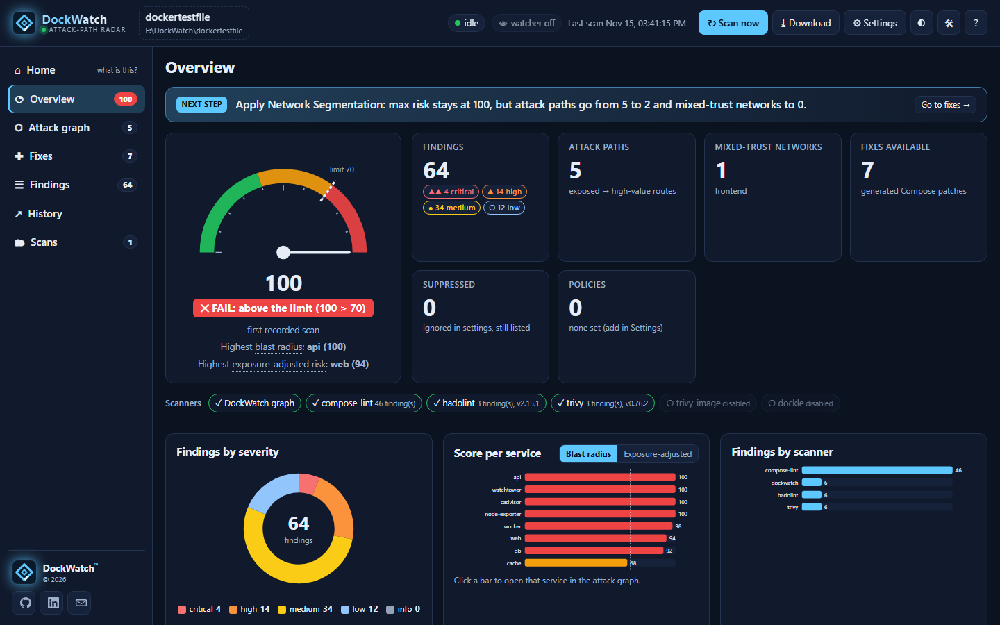

# DockWatch

### Attack-path analysis for Docker Compose

**See how an attacker would move through your Compose stack, then remove those paths with previewed, reversible fixes.**


-2088FF)


<a href="https://github.com/MMoizSiddiqui/DockWatch/releases/latest"></a>

<sub>The download is on the <b>Releases</b> page (also in the right-hand column of this page), not in the file list above: the files here are the guide, the CI template and the demo.</sub>

[Releases](https://github.com/MMoizSiddiqui/DockWatch/releases/latest) ·
[Quick start](#-quick-start) ·
[How it works](#-how-it-works) ·
[Tour](#-a-tour) ·
[CI gate](#-use-it-in-github-actions) ·
[Troubleshooting](#-troubleshooting)

</div>

---

## Why DockWatch?

Container scanners usually answer *"is this one image or this one file bad?"*. Real incidents are **chains**. An internet-facing web container gets compromised. It shares a network with a monitoring sidecar. That sidecar mounts `/var/run/docker.sock`. **Now the attacker owns the host.** No single finding in that chain looks critical on its own.

DockWatch reads the **whole** `docker-compose.yml` and every Dockerfile it builds. It models the stack as a graph of who can reach whom, and answers:

| Question | DockWatch shows |
|---|---|
| *If this service is compromised, how bad is it?* | A **blast-radius score (0–100)** per service, broken down point by point |
| *How would an attacker get from the internet to something that matters?* | **Attack paths**, with a step-by-step **replay** and the **MITRE ATT&CK** technique at each step |
| *What is the smallest change that breaks those paths?* | **Generated Compose and Dockerfile patches**, each one **re-scanned before you apply it**, so you see the new numbers first |
| *Did we get worse? Which commit did it?* | **History** of every scan and a **git timeline** of risk per commit |
| *Can we block risky changes automatically?* | A one-file **GitHub Actions gate** with ✅ / ❌, a job summary, reports and Security-tab findings |

Everything runs **on your machine**. DockWatch reads your files. It never starts, stops or changes your containers, and never uploads your project anywhere.

---

## Two ways to use DockWatch: pick yours

| | **On your Windows PC** (the app) | **In your GitHub repository** (automatic check) |
|---|---|---|
| **What you get** | The full app with dashboard, attack graph, fixes and reports | A ✅ / ❌ check on every push and pull request that changes a compose file or Dockerfile |
| **What you download** | **`DockWatch-1.0.0-windows-x64.zip`** from [Releases](https://github.com/MMoizSiddiqui/DockWatch/releases/latest). Nothing else | **Nothing.** You copy one file, [`ci-template/dockwatch.yml`](ci-template/dockwatch.yml), into your repository |
| **How** | Unzip, double-click `DockWatch.exe` ([Quick start](#-quick-start)) | Save it as `.github/workflows/dockwatch.yml` and commit ([CI guide](#-use-it-in-github-actions)) |

You can use either one, or both: with the same settings, they give the same result.

> **The other files on the Releases page are not for you to download.** `dockwatch-engine-linux-x86_64.tar.gz` is the Linux version of DockWatch, which GitHub's servers download automatically when the CI check runs. `SHA256SUMS.txt` holds the checksums DockWatch uses to verify the downloads.

---

## 🚀 Quick start

**Requirements:** Windows 10 or 11 (64-bit). No Python, no installer, no administrator rights.

1. Download **`DockWatch-1.0.0-windows-x64.zip`** from [**Releases**](https://github.com/MMoizSiddiqui/DockWatch/releases/latest).
2. **Unzip** it, for example to `Documents\DockWatch`. Don't run it from inside the zip.
3. Double-click **`DockWatch.exe`**.

The first start opens a small **setup window**. It downloads the scanners (Hadolint and Trivy) from their official GitHub releases and **checks every file against its SHA-256 checksum** before using it. The download is about 140 MB, so this takes from one to a few minutes depending on your connection. If anything fails, the window says why and what to do, and offers **Retry**.

DockWatch then opens in your browser at **`http://127.0.0.1:8765/`**. It listens on your own computer only, so nobody else on the network can reach it. A small black **DockWatch** window stays open while it runs; **close it to stop DockWatch**.

> **SmartScreen:** Windows may say it "protected your PC", because DockWatch is new and not yet widely downloaded. Click **More info → Run anyway**.

| Optional | Needed for |
|---|---|
| [Docker Desktop](https://www.docker.com/products/docker-desktop/) | Only the image scanners (Trivy image CVEs, Dockle CIS checks). Everything else works without Docker |
| [Git](https://git-scm.com/download/win) | The **git timeline** on the History page |

---

## 🎯 Try it in 2 minutes: the demo

The download includes **`dockertestfile`**, a small online shop built **on purpose** with real-world mistakes:

- a Docker socket mounted into a container on the public network;
- a privileged monitoring container;
- a container sharing the host's process namespace;
- plain-text passwords;
- Dockerfiles that run as root;
- a shared upload volume, and more.

1. In DockWatch, click **📁 Browse…**, pick the `dockertestfile` folder and press **Open and scan**.
2. You get **risk 100, FAIL**: 64 findings, 5 attack paths, 7 generated fixes.
3. Open **Fixes** and apply the **★ recommended next** fix each time:

| Step | Fix applied | Highest risk | Attack paths | Verdict |
|---|---|---|---|---|
| 0 | none | **100** | 5 | ❌ FAIL |
| 1 | Network Segmentation | 100 | 2 | ❌ FAIL |
| 2 | Secret Guard | 77 | **0** | ❌ FAIL |
| 3 | Dockerfile Hardening | 62 | 0 | ✅ PASS |
| 4 | Container Hardening | **56** | 0 | ✅ PASS |

<sub>Measured with DockWatch 1.0.0 on the bundled demo, with the default scanners and the default limit of 70.</sub>

`dockertestfile\VULNERABILITIES.txt` lists every planted weakness, which tool finds it and which fix removes it. To start over, double-click **`dockertestfile\reset-demo.cmd`**.

---

## 📸 A tour

### Attack graph, with step-by-step replay
Services are arranged by **how many steps** an attacker needs from an exposed service. Click a service for its score breakdown and the ATT&CK techniques that apply there. **▶ Replay attack** walks a path one step at a time.

The graph works like a map, for stacks of any size: **scroll to zoom**, **drag to move**, pinch on touch screens, **+ / − / Fit** buttons, and double-click to see everything again. Exposed services glow orange, high-value targets glow red, and mixed-trust connections carry moving dashes.

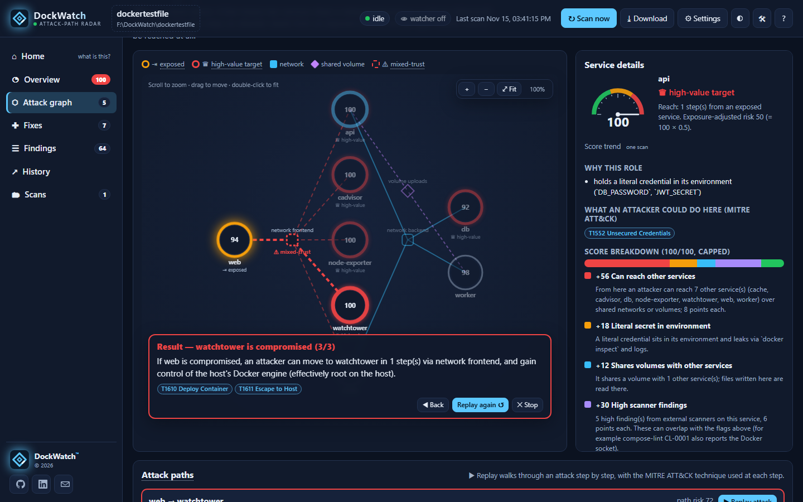

### Attack paths
Every path is a real route from an exposed service to a **high-value target**: the Docker socket, a privileged container, a host namespace or literal credentials. Each step says *why* it is possible, for example "both are on network frontend".

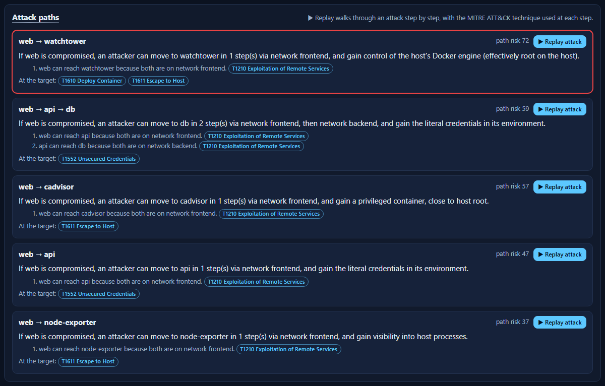

### Fixes, previewed before you apply them
Each fix shows:
- what it does and which services it touches;
- a **what-if** box: max risk, attack paths, mixed-trust networks and findings, *before → after*;
- a side-by-side diff.

Every apply makes a **backup first**, and **Restore** undoes it.

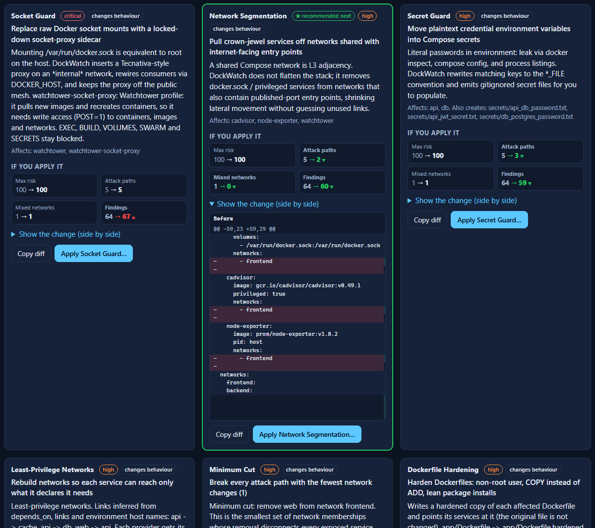

### Findings from every scanner, explained
One table for compose-lint, Hadolint, Trivy, Dockle and DockWatch's own graph rules. Expand any row for **what it means, why it matters and how to fix it**. **Ignore…** accepts a finding *with a reason*; it stays visible under *Show → suppressed* and can be un-ignored.

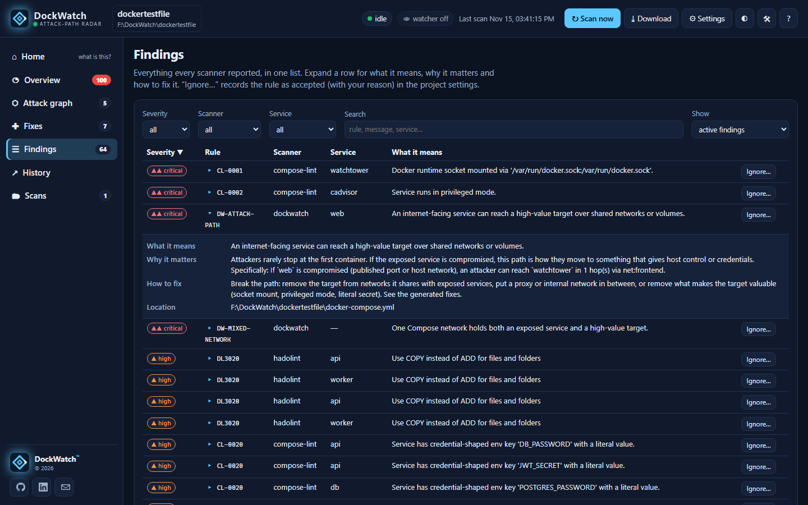

### A scan you can follow
Every scan opens a window that follows the **8 steps** live, with results as each one finishes. You can cancel at any time; a cancelled scan saves nothing and never changes your files.

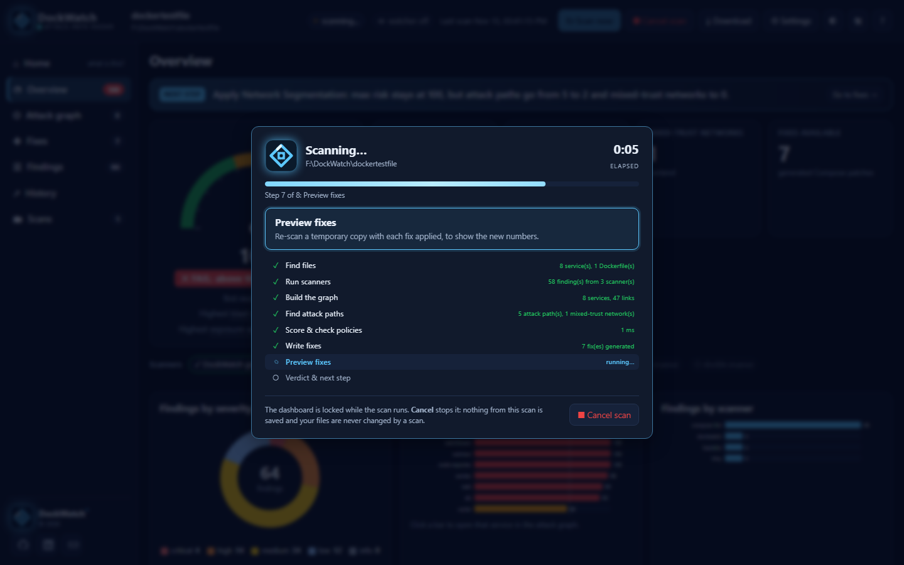

### After the fixes: PASS
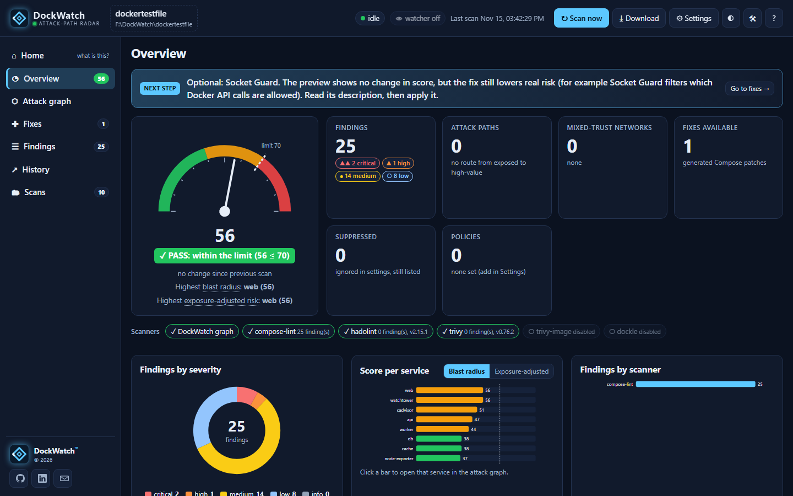

### History and git timeline
The risk of every scan over time, per-service trends, and, for git projects, **the risk at every commit**, so you can see which commit introduced it.

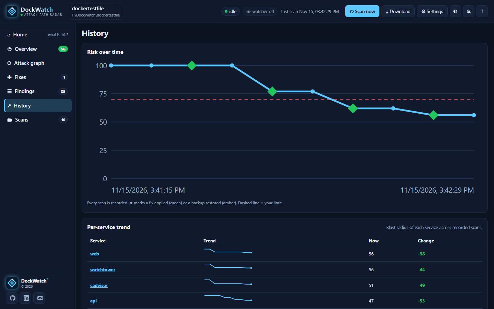

<details>
<summary><b>More screenshots</b>: home, git timeline, saved scans, settings, scanner tools</summary>

<br>

| | |
|---|---|
| 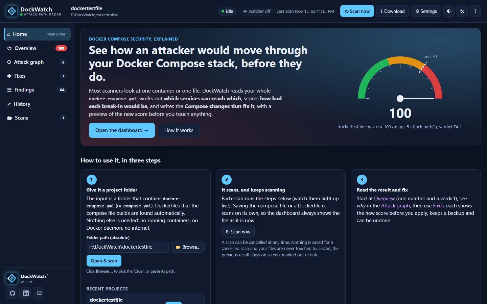 | 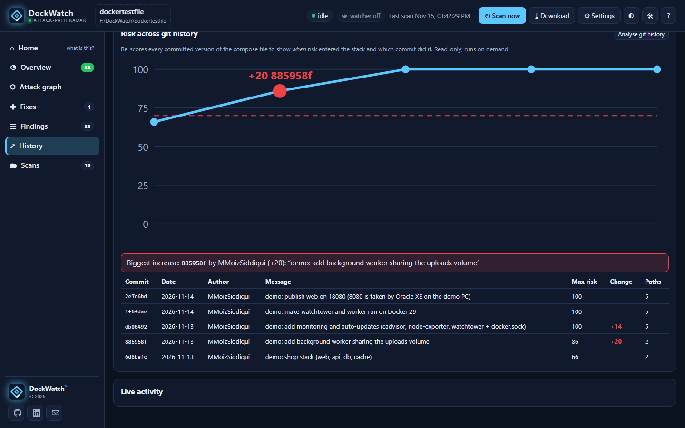 |
| **Home**: open a project, recent projects | **Git timeline**: risk per commit |
| 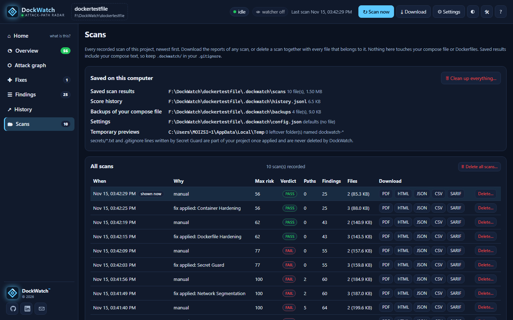 | 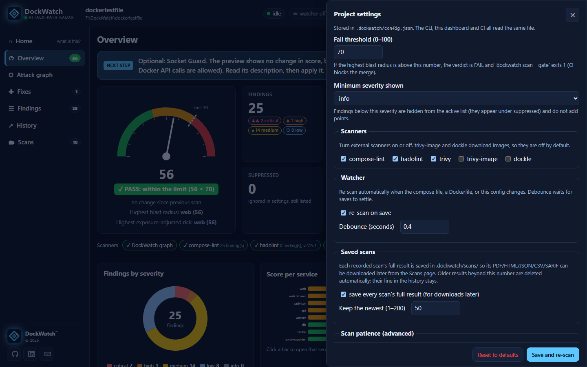 |
| **Scans**: every saved scan with its reports | **Settings**: limit, scanners, policies, scan patience |
| 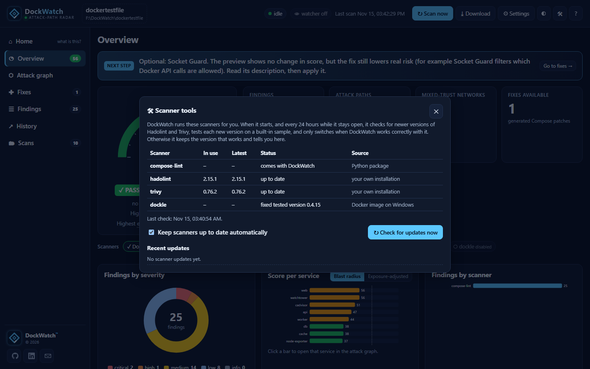 | |
| **Scanner tools**: versions and update history | |

</details>

---

## 🧠 How it works

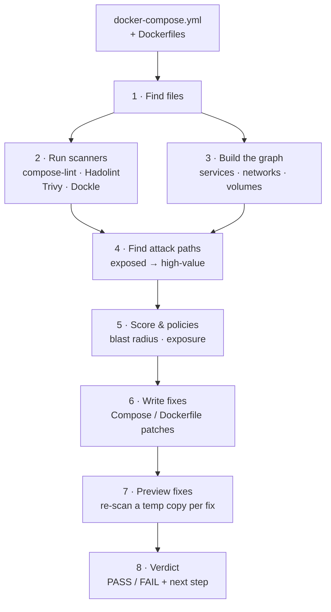

### 1. Model: the reachability graph
DockWatch loads the stack the way `docker compose` does: the Compose file plus its override file (`docker-compose.override.yml`), `include:`d files, `extends:`, and YAML anchors. It reads every Dockerfile the stack builds, then builds a graph.

**Nodes** are services. Each one can be tagged:
- **exposed**: it publishes ports or uses host networking;
- **high-value**: it mounts the Docker socket, runs `privileged`, shares a host namespace (`pid`, `ipc`, host network) or holds a literal secret in its environment.

You can override both tags per service in Settings.

**Edges:**
- Two services on the same **network** can reach each other (L3 adjacency).
- Two services sharing a **volume** can affect each other through files.
- `depends_on` is recorded, but not counted as reachability.

A **mixed-trust network** is one network that holds both an exposed service and a high-value target. It is the most common root cause in real stacks.

### 2. Paths: how an attacker moves
From every exposed service, DockWatch finds the routes to every high-value target. Each path gets:
- a **path risk**, which combines the target's impact with the number of steps;
- a plain-English narrative, for example *"If web is compromised, an attacker can move to watchtower in 1 step via network frontend…"*;
- the **MITRE ATT&CK for Containers** technique at each step. For example: T1210 *Exploitation of Remote Services* for lateral movement; T1610 *Deploy Container* and T1611 *Escape to Host* at a socket or privileged target; T1552 *Unsecured Credentials* at a literal secret.

### 3. Score: explainable, not a black box
Every service gets two numbers:

| Score | Meaning | How |
|---|---|---|
| **Blast radius** (0–100) | *Impact*: how bad is it if **this** service falls? | Points are added up and capped at 100. Points come from: each service it can reach; Docker socket; privileged; host namespace; literal secret; shared volumes; being on a mixed-trust network (8 points each); scanner findings by severity; image CVEs (summarised and capped at 15 points, so they can't drown out the reachability signal) |
| **Exposure-adjusted** | *Impact × likelihood* | Blast radius × a reachability factor: exposed 1.0, one step away 0.5, two steps 0.33, …, unreachable 0.1 (a floor for insiders and supply-chain attacks) |

Every point appears in the UI and in the reports, with a one-line reason. The **gate** compares the **highest blast radius** with your limit (default **70**): above the limit is **FAIL**.

### 4. Fix: generate, preview, apply, undo

| Fix | What it does |
|---|---|
| **Network Segmentation** | Moves high-value services off networks shared with internet-facing entry points |
| **Least-Privilege Networks** | Rebuilds networks so each service reaches only what it needs (based on `depends_on`, `links` and host names in its environment) |
| **Minimum Cut** | Breaks every attack path with the fewest network-membership changes (a graph min-cut) |
| **Socket Guard** | Replaces raw `docker.sock` mounts with a locked-down socket proxy on an internal network, allowing only the API calls that service needs |
| **Secret Guard** | Moves literal credentials into Compose `secrets` (the `*_FILE` convention) and git-ignores the generated secret files |
| **Container Hardening** | Adds `no-new-privileges` and memory / CPU limits, and drops Linux capabilities where it is safe |
| **Dockerfile Hardening** | Writes a hardened copy of each Dockerfile: non-root `USER`, `COPY` instead of `ADD`, lean package installs |

How fixes are written and tested:
- Fixes edit the YAML **round-trip**, so your comments and order are kept.
- Before showing a fix, DockWatch has already **applied it to a temporary copy and re-run the whole analysis**. The *before → after* numbers are measured, not guessed.
- Fixes that can change how your app behaves (for example, a service losing a network) are labelled **changes behaviour**.
- Applying a fix first writes a timestamped backup to `.dockwatch\backups\`; **Restore** puts it back.

### 5. Scanners: run, watched and kept up to date
**Run for you:**
- **compose-lint** is built in;
- **Hadolint** and **Trivy** are downloaded once and checksum-verified;
- **Trivy image** and **Dockle** are optional image scanners that need Docker.

**Watched, not timed out.** DockWatch watches each scanner's CPU, disk/network I/O and output:
- A tool that is *working* (downloading, reading, computing) is not stopped for being slow. The only exception is a 60-minute safety limit per file or image, which **Custom** scan patience raises to up to 4 hours for very large images on slow connections.
- A tool that does *nothing* for 3 minutes is stopped.
- DockWatch also learns how long each tool normally takes, so it can spot one that is running in circles.
- Anything that could not be scanned is listed in every report as **NOT SCANNED**, with the reason, and the report's **Coverage** line says **INCOMPLETE**.

**Self-updating, safely.** Once a day while DockWatch is open, and on every CI run, it checks for new scanner versions. Each new version is:
1. checksum-verified;
2. **self-tested on a built-in sample with known answers**;
3. only then used.

If a new version misbehaves, DockWatch **keeps the working one** and tells you, with a one-click *Ask the developer to support it*.

### 6. Reports

| Format | For |
|---|---|
| **PDF** | People (management, audits, coursework): score, verdict, attack paths, every finding, fixes, coverage |
| **HTML** | The same in one self-contained page; open or attach it anywhere |
| **JSON** | The full analysis, for scripts and dashboards |
| **CSV** | The findings, as a spreadsheet |
| **SARIF 2.1.0** | GitHub code scanning (the Security tab), and IDEs that read SARIF |

### Security of DockWatch itself
- The dashboard listens on **127.0.0.1 only**.
- API calls that change anything require a custom header, so other websites cannot trigger them (CSRF protection).
- No CDN, no telemetry, no account. Downloaded tools are checked against SHA-256 checksums.
- Text from scanned files is always shown as text, never run as HTML.
- Your files change **only** when you press *Apply*, and always with a backup first.

---

## ⚙️ Settings (per project)

Open **⚙ Settings** in the top bar. They are saved in `<project>\.dockwatch\config.json`; commit that file if your team should share them.

| Setting | Default | What it does |
|---|---|---|
| Fail limit | 70 | Highest blast radius allowed before **FAIL** |
| Scanners | all except the image scanners | Turn each scanner on or off |
| Minimum severity | info | Hide findings below this level |
| Team policies | none | Rules such as *no shared network between exposed and high-value services*, *no attack paths*, *max blast radius* or *no service with flag X*. Broken policies are shown and reported |
| Ignored rules / services | none | Accepted risks, each **with a reason**; still listed as *suppressed* |
| High-value / exposed overrides | automatic | Correct DockWatch's classification of a service |
| **Scan patience** | Default | **Default**: stop a tool after 3 minutes without *any* activity. **Custom**: sliders for that limit (1–15 min) and an absolute limit per file or image (10–240 min) |

---

## 🛡 Use it in GitHub Actions

Add **one file** to any repository, and every push or pull request that touches a compose file or a Dockerfile is checked:

1. Copy [`ci-template/dockwatch.yml`](ci-template/dockwatch.yml) into your repository as **`.github/workflows/dockwatch.yml`**.
2. Commit it. That's all.

Each run:
1. downloads the DockWatch Linux engine from this repository's Releases and **verifies its checksum**;
2. installs and self-tests the scanners;
3. scans your project.

You then get:
- ✅ / ❌ on the commit or pull request. With branch protection, ❌ blocks the merge;
- a **job summary** with the verdict and the full output;
- the **HTML report, SARIF and log** attached to the run;
- findings in the repository's **Security → Code scanning** tab (free on public repositories).

All the options (limit, severity, image scanning, skipped scanners, auto-update, scan patience) are in a clearly marked **YOUR SETTINGS** block at the top of the file. Full guide: [`ci-template/README.md`](ci-template/README.md).

---

## ⌨️ Command line

The download also contains the engine, for scripts and pipelines:

```bat
engine\dockwatch-engine.exe scan "C:\path\to\project" --gate --pdf report.pdf
```

| Command | Purpose |
|---|---|
| `scan <folder>` | Analyse a project. `--gate` exits with **1 on FAIL** and **0 on PASS**. Reports: `--pdf`, `--report` (HTML), `--csv`, `--sarif`, `--json`. Options: `--fail-blast-radius N`, `--min-severity`, `--enable-scanner` / `--disable-scanner`, `--stall-minutes`, `--max-minutes` |
| `apply <folder> --kind <fix>` | Apply a generated fix, with a backup |
| `restore <folder>` | List backups, or restore one with `--name` |
| `git-history <folder>` | Risk at each commit |
| `scans <folder>` | List, delete or clean saved scans |
| `setup` / `update --status` | Install, check or update the scanners |

Add `--help` to any command to see all its options.

---

## 📁 Where DockWatch keeps things

| Where | What |
|---|---|
| `<project>\.dockwatch\config.json` | That project's settings. Commit it to share them with your team |
| `<project>\.dockwatch\` (everything else) | History, saved scans and fix backups. Keep these out of git |
| `%LOCALAPPDATA%\DockWatch\` | Scanners, recent projects, learned scan timings and logs (`setup.log`, `server.log`) |

Deleting `%LOCALAPPDATA%\DockWatch` makes the next start a first start again.

---

## ❓ Troubleshooting

| Problem | What to do |
|---|---|
| The setup window shows an error | Read its *What to do* box; most problems are a blocked internet connection or a proxy. Press **Retry**. Full log: `%LOCALAPPDATA%\DockWatch\setup.log` |
| "Port 8765 is already used" | DockWatch is probably already running; look for its black window. Otherwise, close the program that uses that port |
| A scanner shows *skipped* | **🛠 Scanner tools** says why. The image scanners need Docker Desktop running *and* must be turned on in ⚙ Settings |
| A report says **INCOMPLETE** | Something could not be scanned; the report lists each item and the reason |
| Nothing happens on double-click | Make sure the whole folder was unzipped: `DockWatch.exe` needs the `engine` folder next to it |
| The git timeline is empty | Install Git, and make sure the project folder is a git repository with commits |

Questions, bugs or ideas: **[open an issue](https://github.com/MMoizSiddiqui/DockWatch/issues)**.

---

## 📜 Licence

DockWatch is **free to use**, including at work and in CI, under the [DockWatch End-User Licence](LICENSE). The program code is not published; copying, modifying or reverse-engineering it is not allowed. The open-source components DockWatch includes or downloads keep their own licences: see [THIRD_PARTY_NOTICES.md](THIRD_PARTY_NOTICES.md).

<div align="center">

© 2026 DockWatch Team · [GitHub](https://github.com/MMoizSiddiqui) · [LinkedIn](https://www.linkedin.com/in/muhammad-moiz-siddiqui-99357229a/)

</div>
